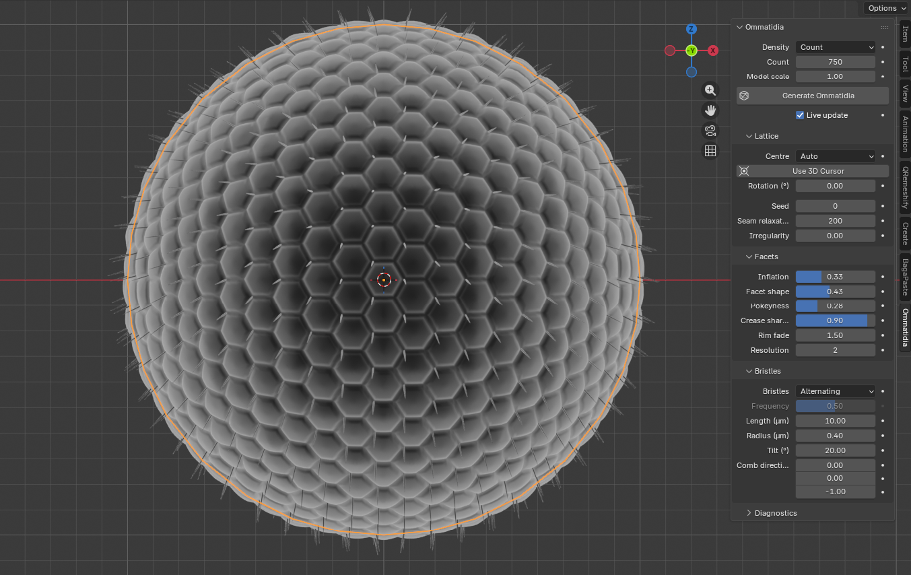
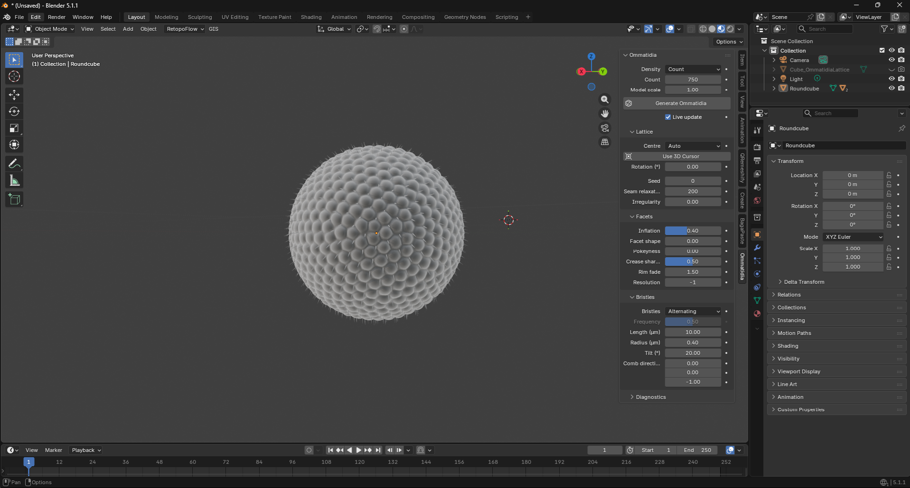

# Ommatidia

A free Blender extension that covers any mesh with a **regular lattice of insect
ommatidia**: domed corneal lenses (compound-eye facets) with optional
interommatidial bristles. Cover a whole sculpted head, or only an eye region cut
out of it.

Facets are spaced evenly **on the surface itself**, not in UV space, so they
don't stretch, whatever your topology, UVs or triangle sizes look like. The
defaults come from scanning electron micrographs (SEM) of the fruit fly
*Drosophila melanogaster*.



- **Blender:** 4.2 LTS or newer (tested on 4.5 and 5.1)
- **Version:** 0.2.1 (early release)
- **License:** GPL-3.0-or-later
- **Dependencies:** none beyond Blender's bundled Python and numpy

## Install

1. Download `ommatidia-<version>.zip` from the
   [Releases page](https://github.com/UGarCil/Blender_Ommatidia/releases).
   Don't unzip it.
2. In Blender: *Edit ▸ Preferences ▸ Get Extensions ▸ ⌄ (top-right menu) ▸
   Install from Disk…* and pick the zip.
3. The panel appears in the 3D Viewport sidebar (**N**) under **Ommatidia**.

To build the zip yourself from this repository:

```sh
mkdir -p dist
blender --factory-startup --command extension build --source-dir src/ommatidia --output-dir dist
```

## Quick start

1. Select the mesh to cover. Open the sidebar (**N**) ▸ **Ommatidia**.
2. Choose a density: **Count** (default 750, a female *Drosophila* eye) or
   **Spacing** in real µm (default 16 µm, together with a *Model scale*).
3. Click **Generate Ommatidia**. A new object `<YourMesh>_Ommatidia` appears,
   parented to your mesh. Your mesh itself is never modified.
4. Adjust the settings. Facet and bristle shapes update instantly; lattice
   settings regenerate about half a second after you stop changing them.



## What you can control

- **Facets:** dome height (*Inflation*), round domes ↔ flat hexagons
  (*Facet shape*), *Pokeyness*, *Crease sharpness*, *Rim fade* on open
  sheets, mesh *Resolution*.
- **Bristles:** *Alternating* (one per ommatidium, as in *Drosophila*),
  *Random* or *None*; length, radius, tilt and comb direction.
- **Lattice:** where the perfect hexagonal patch starts (auto, 3D cursor, an
  object or a point), its rotation, seed and irregularity.
- **Look:** an "Ommatidia SEM" material that mimics an electron micrograph.
  Your own materials in its slots are kept when you regenerate.

## Good to know

- **Smooth meshes work best.** Sharp creases (about 45° or more, like a raw
  cube) break some facet walls. Add a Subdivision Surface or Bevel modifier;
  the add-on reads the modified mesh without applying anything.
- **A few 5- and 7-sided facets are unavoidable** on a curved surface, as on
  real eyes. The add-on pushes them into seams away from the centre you choose.
- **Render cost** is modest: one plain mesh, about 110k faces at the defaults.
- **Facet size is uniform** in this version, so eyes with large dorsal facets
  (e.g. dragonflies) aren't modelled yet.

## Documentation

- [User guide](docs/user/README.md): every setting, tips, and headless batch
  runs with `main.py`
- [How the code is organised](docs/user/modules.md)
- [Data definitions](docs/agents/data_definitions.md) and
  [module structure](docs/agents/modules.md) for developers

## Roadmap

Bristle sockets, corneal nipples (the sub-micron lens nanostructure), presets
(*Drosophila*, wasp, dragonfly) and spatially varying facet size.

## Feedback and bugs

Open an [issue](https://github.com/UGarCil/Blender_Ommatidia/issues). Please
include your Blender version, the numbers from the add-on's **Diagnostics**
panel and, if possible, the mesh.

## Running the tests

```sh
pytest test/                                                        # pure Python + numpy
blender -b --factory-startup --python test/run_blender_tests.py     # inside Blender
```
